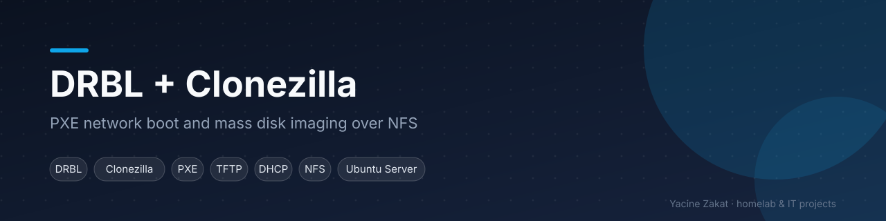
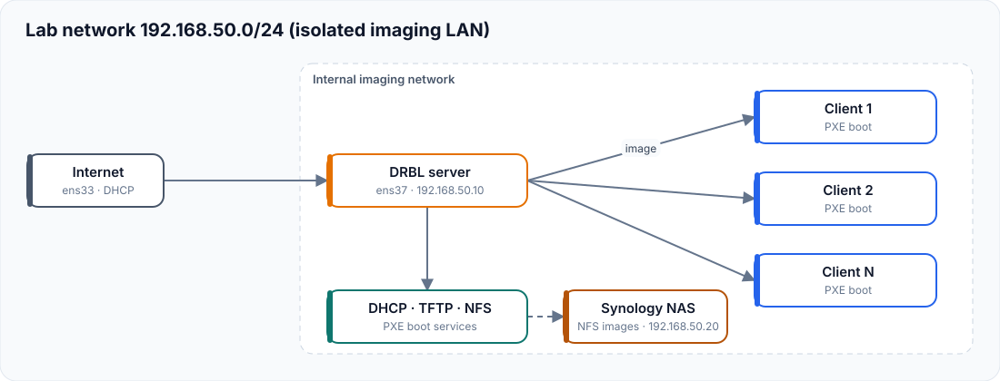

# DRBL + Clonezilla — PXE network boot and mass imaging

A lab in which one Ubuntu server boots client machines over the network (PXE) and deploys or captures disk images with Clonezilla, stored centrally on a NAS over NFS. This is how a support team re-images a classroom or a fleet of PCs in one pass.

| | |
|---|---|
| **Status** | Lab project (virtualised imaging network) |
| **Stack** | Ubuntu Server · Synology NAS · DRBL · Clonezilla · isc-dhcp-server · tftpd-hpa · NFS · Netplan |
| **Guide** | Full step-by-step guide in French: [GUIDE-FR.md](GUIDE-FR.md) |

## Architecture

The server has two interfaces: one for Internet access (DHCP) and one static interface that serves an **isolated imaging network**, so the lab DHCP server never interferes with a production LAN.

| Element | Lab value |
|---|---|
| Imaging network | `192.168.50.0/24` (isolated lab) |
| DRBL server, internal NIC | `192.168.50.10` |
| DHCP pool for clients | `192.168.50.100 – 192.168.50.150` |
| NAS (Synology, NFS image store) | `192.168.50.20` |

## Steps (summary)

1. Two NICs configured with Netplan (DHCP upstream, static on the imaging side)
2. Install `drbl`, `nfs-kernel-server`, `tftpd-hpa`, `isc-dhcp-server`, `syslinux`
3. `drblsrv -i` — prepares the boot images
4. `drblpush -i` — configures DHCP, TFTP and NFS for the clients
5. Synology NAS share mounted over NFS as the Clonezilla image repository (`/home/partimag`)
6. Custom PXE menu entry boots Clonezilla Live over NFS with the image store pre-mounted
7. Clients boot over PXE: capture an image from a reference PC, restore it to the others

## Skills demonstrated

PXE / network boot · DHCP · TFTP · NFS · Linux networking (Netplan) · disk imaging and deployment · lab isolation

---
**Yacine Zakat** — IT Support & Application Support Technician
